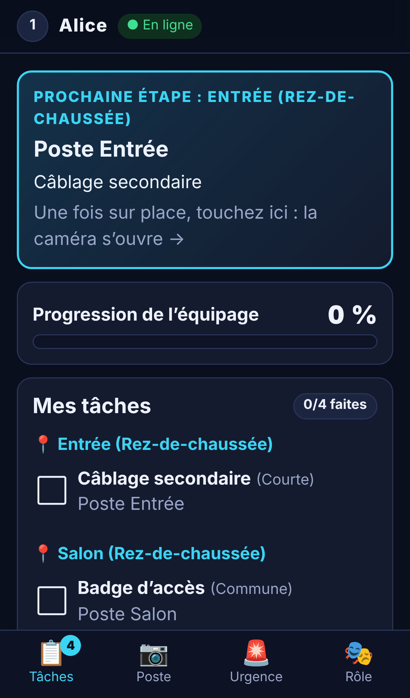

# Imposteurs — Among Us grandeur nature

Un site web gratuit pour jouer à un jeu de rôles cachés **inspiré d’Among Us** dans une vraie maison, de 4 à 40 joueurs, chacun avec son téléphone. Le site gère les rôles secrets, les tâches (QR codes posés dans les pièces), les éliminations, les corps, les sabotages, les réunions, les votes et les conditions de victoire. Le maître du jeu (MJ) dispose d’un tableau de bord complet.

- Aucune application à installer (installation facultative sur l’écran d’accueil : PWA).
- Aucun compte joueur, aucune publicité, aucune donnée personnelle (seulement un pseudonyme, effacé 7 jours après la partie).
- Hébergement **gratuit** sur Cloudflare (offre « Workers Free »).
- Alertes plein écran avec son et vibration, et **notifications push** quand l’écran est verrouillé (voir [alertes et notifications](docs/alertes-notifications.md)).
- Onglet **🧪 Tests** pour le MJ : vérifier chaque fiche posée et jouer chaque tâche avant la partie.

> Projet de fans, non affilié à Innersloth. Aucun élément graphique, sonore ou textuel du jeu original n’est utilisé.



---

## 1. Démarrage express (pour le maître du jeu)

1. **Mettre le site en ligne une fois pour toutes** (section 3 ; 10 minutes, gratuit). Vous obtenez une adresse du type `https://imposteurs.votre-nom.workers.dev`.
2. **Imprimer le kit de fiches, une fois pour toutes** : ouvrez cette adresse → **J’organise** → **🖨 Imprimer le kit** (ou le [PDF du dépôt](docs/pdf/kit-fiches.pdf)). Ces fiches servent pour toutes vos parties et toutes les maisons ; il n’y a rien d’autre à imprimer.
3. **Créer la partie** : **J’organise** → **Créer une nouvelle partie** (aucune maison n’existe d’avance). Notez le **code maître du jeu** affiché.
4. **Poser et appairer les fiches** : une fiche « Poste » par pièce, le bouton d’urgence dans la salle de réunion ; onglet **Terrain** → **📷 Appairer des fiches** : scannez chaque fiche posée et touchez sa pièce. Les tâches se répartissent toutes seules ; une fiche non appairée n’existe pas pour le jeu (voir [Installer la maison](docs/installation-terrain.md)).
5. Onglet **Paramètres** : nombre d’imposteurs (ou **Automatique**) ; onglet **🧪 Tests** : scannez chaque fiche posée et testez chaque tâche.
6. Invitez : montrez le QR code du tableau de bord (ou partagez le lien). Les joueurs scannent, choisissent un pseudonyme, arrivent dans le salon.
7. Demandez à chacun de régler ses **alertes** (carte du salon), touchez **Faire sonner tous les téléphones**, présentez la **sécurité** (`docs/securite-urgence.md`) et le **résumé des règles**, puis **Démarrer la partie**. Annoncez aussi les réunions à voix haute.

Tout est détaillé dans le [guide du maître du jeu](docs/guide-maitre-du-jeu.md) et les [checklists](docs/checklists.md).

## 2. Documents

| Pour qui | Document | PDF |
|---|---|---|
| Tous | [Résumé des règles](docs/resume-regles.md) | [PDF](docs/pdf/resume-regles.pdf) |
| Tous | [Règlement complet](docs/regles-joueurs.md) | [PDF](docs/pdf/regles-joueurs.pdf) |
| Tous | [Sécurité et procédure d’urgence](docs/securite-urgence.md) | [PDF](docs/pdf/securite-urgence.pdf) |
| Équipage | [Guide de l’équipage](docs/guide-equipage.md) | [PDF](docs/pdf/guide-equipage.pdf) |
| Imposteurs | [Guide des imposteurs](docs/guide-imposteurs.md) | [PDF](docs/pdf/guide-imposteurs.pdf) |
| Morts | [Guide des fantômes](docs/guide-fantomes.md) | [PDF](docs/pdf/guide-fantomes.pdf) |
| MJ | [Guide du maître du jeu](docs/guide-maitre-du-jeu.md) | [PDF](docs/pdf/guide-maitre-du-jeu.pdf) |
| MJ | [Installer la maison](docs/installation-terrain.md) | [PDF](docs/pdf/installation-terrain.pdf) |
| MJ | [Checklists avant / pendant / après](docs/checklists.md) | [PDF](docs/pdf/checklists.pdf) |
| Tous | [Alertes, sons et notifications : fonctionnement et conseils](docs/alertes-notifications.md) | [PDF](docs/pdf/alertes-notifications.pdf) |
| MJ | [Mécaniques du jeu vidéo impossibles en vrai, et ce qui les remplace](docs/limites-mecaniques.md) | [PDF](docs/pdf/limites-mecaniques.pdf) |
| MJ | Kit de fiches universel (imprimé une fois pour toutes) | [PDF](docs/pdf/kit-fiches.pdf) |
| MJ | [Tâches et supports imprimables](docs/taches-et-supports.md) | [PDF](docs/pdf/taches-et-supports.pdf) |
| Curieux | [Recherche des règles officielles + matrice d’adaptation](docs/recherche-regles.md) | [PDF](docs/pdf/recherche-regles.pdf) |
| Technique | [Conception (architecture, sécurité, quotas)](docs/conception.md) | [PDF](docs/pdf/conception.pdf) |
| Technique | [Rapport de tests](docs/tests.md) | [PDF](docs/pdf/tests.pdf) |

Les règles affichées dans l’application (bouton « Règles ») sont **les mêmes fichiers** que ceux de `docs/` : il n’existe qu’une seule version du règlement. Les fiches, étiquettes, badges et l’affiche d’invitation forment le kit universel, imprimé une fois pour toutes (accueil → **J’organise** → **Imprimer le kit**).

## 3. Mise en ligne (gratuite)

Il faut **un compte Cloudflare gratuit** — c’est la seule action manuelle indispensable : personne ne peut le créer à votre place. Créez-le sur <https://dash.cloudflare.com/sign-up> (adresse e-mail + mot de passe ; l’offre Workers Free est gratuite et sans limite de durée).

### Option A — sans rien installer (recommandée)
1. Dans le tableau de bord Cloudflare : **Workers & Pages** → **Create application** → onglet **Workers** → **Import a repository** / **GitHub**, autorisez l’accès à votre compte GitHub et choisissez le dépôt `amongus`.
2. Réglages du projet :
   - **Project name / Worker name** : `imposteurs` (doit être identique au champ `name` de `wrangler.jsonc`).
   - **Build command** : `npm run build`
   - **Deploy command** : `npx wrangler deploy` (valeur par défaut)
   - **Branch** : `main`.
3. **Save and Deploy**. Après une à deux minutes, l’adresse `https://imposteurs.<votre-sous-domaine>.workers.dev` est affichée. Ouvrez-la sur votre téléphone : c’est prêt.
4. Chaque nouveau commit sur la branche choisie redéploie automatiquement le site.

### Option B — par GitHub Actions
Le fichier `.github/workflows/deploy.yml` déploie à chaque push sur `main` **si** deux secrets existent dans le dépôt GitHub (*Settings → Secrets and variables → Actions*) :
- `CLOUDFLARE_API_TOKEN` : Cloudflare → *My Profile → API Tokens → Create Token → modèle « Edit Cloudflare Workers »* ;
- `CLOUDFLARE_ACCOUNT_ID` : visible dans le tableau de bord Cloudflare (colonne de droite de *Workers & Pages*).

### Option C — depuis un ordinateur
```bash
npm install
npx wrangler login      # ouvre le navigateur pour vous connecter à Cloudflare
npm run deploy          # construit et publie ; l'adresse .workers.dev s'affiche à la fin
```

### Option D — sans compte, sur le Wi-Fi de la maison
Un ordinateur portable peut servir de serveur pour la soirée : `npm install` puis `npm run local`. Les joueurs, connectés au **même Wi-Fi**, ouvrent `http://<adresse-IP-de-l-ordinateur>:8787` (l’adresse IP s’obtient dans les réglages réseau de l’ordinateur). Limites : l’ordinateur doit rester allumé et éveillé ; en HTTP la caméra ne peut pas lire les QR codes (les joueurs tapent les codes à la main) et l’installation PWA est indisponible.

### Mettre à jour le site
- Option A : poussez les modifications sur la branche suivie, Cloudflare redéploie seul.
- Option B : poussez sur `main`.
- Option C : `git pull` puis `npm run deploy`.
Les parties en cours ne sont pas perdues (l’état est stocké côté serveur), mais évitez de mettre à jour pendant une partie.

## 4. Organiser une nouvelle partie
- **Même soirée, mêmes joueurs** : à la fin, le MJ touche **Nouvelle partie** ; tout le monde revient au salon, le terrain et les réglages sont conservés, le lien et l’affiche restent valables.
- **Nouvelle soirée** : **Créer une nouvelle partie** ; le terrain et les réglages enregistrés sur l’appareil du MJ sont repris automatiquement. Les fiches déjà imprimées restent valables tant que vous ne régénérez pas les postes (exception : les bandes « puzzle » imprimées avant la version à deux lettres doivent être réimprimées).
- **Changer d’appareil de MJ** : « Reprendre une partie sur cet appareil » avec le code de partie et le code maître du jeu ; pour réutiliser le terrain, **Exporter** puis **Importer** le fichier de terrain.

## 5. Sauvegarde et récupération
- **Terrain** : bouton *Exporter (fichier)* dans l’onglet Terrain (fichier JSON à garder), *Importer* pour le recharger. Il est aussi mémorisé automatiquement dans le navigateur du MJ.
- **Partie en cours** : stockée par le serveur (survit aux redémarrages, aux rechargements de page et aux pertes de réseau). Elle est **effacée automatiquement 7 jours** après la dernière activité.
- **Joueur qui a perdu sa session** (nouveau téléphone, navigation privée) : le MJ génère un **code de reconnexion** (onglet Joueurs → Gérer), le joueur le saisit sur l’accueil → « Récupérer ma session ».
- **MJ qui a perdu son appareil** : code de partie + code maître du jeu, depuis n’importe quel appareil.

## 6. Coût et limites
| Service | Utilisation | Offre gratuite (vérifiée le 27/10/2026) | Consommation estimée (40 joueurs, 2 h) |
|---|---|---|---|
| Cloudflare Workers (fichiers statiques) | pages, scripts, icônes | gratuit et illimité | — |
| Cloudflare Workers (requêtes) | création de partie, connexions WebSocket | 100 000 / jour | quelques centaines |
| Durable Objects SQLite | serveur de partie temps réel | 100 000 requêtes/jour (messages WebSocket entrants comptés 1/20), 13 000 Go·s/jour, 100 000 lignes écrites/jour, 5 Go | ~1 000 requêtes, ~920 Go·s au maximum, < 20 000 lignes |
| Sous-domaine `workers.dev` + HTTPS | adresse du site | gratuit | — |

Il n’y a **aucun frais**, aucune clé d’API, aucun domaine à acheter. Si un quota quotidien était dépassé, les nouvelles actions échoueraient jusqu’à 0 h UTC (rien n’est facturé sur l’offre gratuite). Cela n’arriverait qu’avec des dizaines de grosses parties le même jour. Détails : [docs/conception.md](docs/conception.md).

## 7. Pour les développeurs

### Lancer en local
```bash
npm install
npm run dev            # construit l'interface puis lance le serveur sur http://localhost:8787
# ou, avec rechargement à chaud de l'interface :
npx wrangler dev --port 8787   # serveur (terminal 1, après un premier `npm run build`)
npm run dev:client             # interface Vite sur http://localhost:5173 (terminal 2)
```

### Tests
```bash
npm run typecheck          # TypeScript strict (client + serveur)
npm test                   # tests unitaires + simulation aléatoire de centaines de parties (SIM_GAMES=300 pour plus)
npx vitest run --coverage  # idem avec mesure de couverture du moteur
npm run test:integration   # serveur local réel + 40 téléphones simulés (WebSocket)
npm run test:browser       # Chromium : parcours complet sur écrans de téléphone (nécessite Playwright)
npm run docs:pdf           # régénère les PDF de docs/pdf (nécessite Playwright)
```

### Structure
```
src/shared/       moteur de règles pur (engine.ts), vues filtrées (view.ts), terrain, mini-jeux, paramètres
src/worker/       Worker Cloudflare (index.ts) et Durable Object d'une partie (game-room.ts)
src/client/       application mobile Preact : joueur (player.tsx), MJ (gm.tsx, gm-tests.tsx), alertes et notifications (alerts*.ts[x]), terrain, impression, mini-jeux, entraînement
public/           manifeste PWA, service worker, icônes
test/             unitaires, intégration (wrangler dev), navigateur (Playwright)
docs/             règles, guides, recherche, conception, tests, PDF, captures d'écran
scripts/          génération des icônes et des PDF
wrangler.jsonc    configuration Cloudflare (Durable Object SQLite, fichiers statiques)
```

### Principes
- Le serveur (Durable Object) est la seule source de vérité ; le navigateur n’envoie que des intentions, toutes vérifiées.
- Chaque appareil ne reçoit que ce qu’il a le droit de savoir (rôles, codes de postes, réponses, votes et journal secret restent sur le serveur).
- Dépendances d’exécution : `preact`, `qrcode`, `jsqr` (chargé seulement à l’ouverture de la caméra), `marked`. Notifications push sans bibliothèque : WebCrypto (`src/shared/webpush.ts`, vérifié avec le vecteur officiel de la RFC 8291).
- Variables d’environnement : aucune pour fonctionner (voir `.env.example` pour le déploiement automatique).
